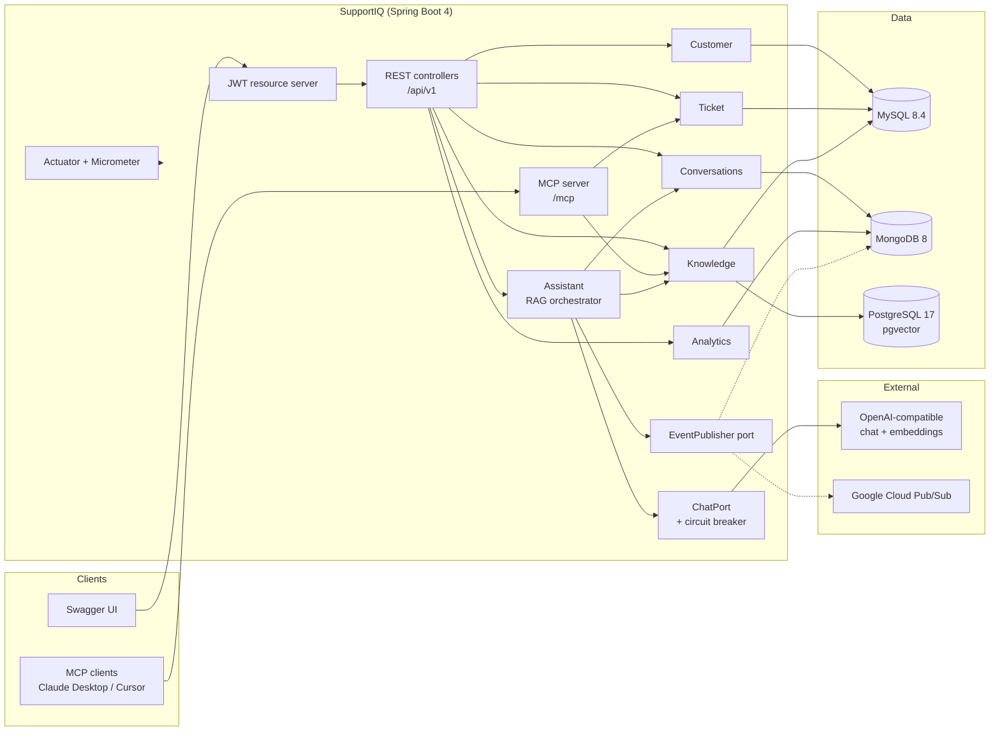
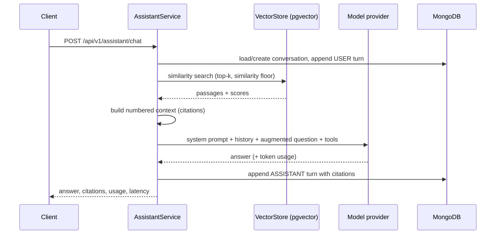

# SupportIQ — AI Customer Support Copilot

A production-shaped **REST backend** that answers customer-support questions with retrieval-augmented
generation, exposes the same support data to AI agents over **MCP**, and keeps transactional,
document and vector data in the store that fits each workload.

Built with **Java 25**, **Spring Boot 4.1.2** and **Spring AI 2.0.2** — the current stable releases.

```
MySQL 8.4   → customers, tickets, knowledge metadata (system of record)
MongoDB 8   → AI transcripts, audit trail, usage analytics
Postgres 17 → pgvector embeddings (HNSW, cosine similarity)
```

---

## Why this domain?

Support copilots are one of the few products where every listed technology is genuinely necessary
rather than bolted on:

- a **relational** store for customers/tickets that need constraints and transactions,
- a **document** store for append-heavy conversation transcripts with citations,
- a **vector** store for semantic retrieval over a knowledge base,
- **tool calling / MCP** so the assistant can act on tickets, not just talk,
- **async events** for auditing and downstream automation,
- **JWT security**, **resilience** and **observability** because it is a real backend.

## What it demonstrates

| Capability | Implementation |
| --- | --- |
| Spring Boot 4 | `4.1.2`, modular starters (`spring-boot-starter-webmvc`), graceful shutdown, virtual threads |
| Spring AI 2 | `ChatClient`, embeddings, tool calling, structured output, SSE streaming, prompt resources |
| RAG | ingest → chunk → embed → pgvector → retrieve → augment → generate → cite |
| PGVector | dedicated PostgreSQL datasource, HNSW index, cosine distance, metadata filters |
| MCP | Streamable-HTTP server at `/mcp` with read-only and write tool hints |
| MySQL | JPA aggregates, optimistic locking, JPA Specifications, Flyway migrations |
| MongoDB | conversation transcripts, audit events, aggregation-based usage analytics, atomic `$push` |
| Messaging | `EventPublisher` port: in-process adapter (default) + Google Cloud Pub/Sub adapter (`gcp` profile) |
| Swagger / OpenAPI | springdoc-openapi `3.2.0`, bearer auth, request duration |
| Actuator | health (incl. AI provider + circuit-breaker state), Prometheus, metrics, loggers, probes |
| Security | stateless JWT resource server, role claims, dev token endpoint (switchable) |
| Resilience | Resilience4j circuit breaker + bounded retry around every blocking model call |
| Caching | Caffeine cache-aside for immutable knowledge metadata |
| Testing | domain tests, prompt tests, chunker tests, ArchUnit layering rules |
| Delivery | Maven wrapper, multi-stage Dockerfile, Docker Compose, GitHub Actions CI |

## Architecture



### Data ownership

| Concern | Store | Why |
| --- | --- | --- |
| Customers, tickets, messages | MySQL | foreign keys, unique references, optimistic locking |
| Knowledge document metadata + full text | MySQL | transactional system of record, content-hash idempotency |
| Chunk embeddings | PostgreSQL + pgvector | ANN search with HNSW and JSON metadata filters |
| Conversation transcripts + citations | MongoDB | unbounded, append-only, read as one aggregate |
| Audit trail | MongoDB | schema-flexible event payloads, async writes |
| Usage analytics | MongoDB | aggregation over embedded turn arrays |

### Chat request flow



## Tech stack

| Area | Choice | Version |
| --- | --- | --- |
| Language | Java (LTS) | 25 |
| Framework | Spring Boot | 4.1.2 |
| AI | Spring AI | 2.0.2 |
| Relational DB | MySQL | 8.4 LTS |
| Document DB | MongoDB | 8 |
| Vector DB | PostgreSQL + pgvector | 17 |
| API docs | springdoc-openapi | 3.2.0 |
| Resilience | Resilience4j | 2.3.0 |
| Build | Maven (wrapper included) | 3.9.11 |
| Cloud messaging (optional) | Google Cloud Pub/Sub | 1.151.0 |

## Quick start

**Prerequisites:** Docker, Java 25, an OpenAI-compatible API key (OpenAI, or any gateway that
speaks the same protocol).

```bash
# 1. Start the three datastores
docker compose up -d mysql mongodb pgvector
docker compose ps          # wait for "healthy"

# 2. Configure secrets
cp .env.example .env
# edit .env and set OPENAI_API_KEY (plus JWT_SECRET for anything beyond a demo)

# 3. Run
set -a && source .env && set +a
./mvnw spring-boot:run
```

- Swagger UI: <http://localhost:8080/swagger-ui.html>
- OpenAPI JSON: <http://localhost:8080/v3/api-docs>
- Health: <http://localhost:8080/actuator/health>
- Prometheus: <http://localhost:8080/actuator/prometheus>
- MCP endpoint: `http://localhost:8080/mcp`

Get a development token and store it:

```bash
TOKEN=$(curl -s -X POST http://localhost:8080/api/v1/auth/token \
  -H 'Content-Type: application/json' \
  -d '{"username":"reviewer"}' | jq -r .accessToken)
```

### Five-minute demo

```bash
# 1. Create a customer (seed data already includes Ada Lovelace, id 1)
curl -s -X POST http://localhost:8080/api/v1/customers \
  -H "Authorization: Bearer $TOKEN" -H 'Content-Type: application/json' \
  -d '{"name":"Linus Torvalds","email":"linus@example.com","company":"Kernel Co","tier":"PREMIUM"}'

# 2. Ingest a knowledge document (idempotent by content hash)
curl -s -X POST http://localhost:8080/api/v1/knowledge/documents \
  -H "Authorization: Bearer $TOKEN" -H 'Content-Type: application/json' \
  -d '{
        "title":"Export limits and troubleshooting",
        "source":"help/exports.md",
        "tags":["exports","limits"],
        "content":"Exports above 10,000 rows must be requested asynchronously. Small exports stream directly. When a large export returns HTTP 500, check the export-worker queue depth and retry with a date range smaller than 30 days. Scheduled exports are capped at 50,000 rows."
      }'

# 3. Semantic search (shows similarity scores and source metadata)
curl -s "http://localhost:8080/api/v1/knowledge/search?q=large%20export%20failing" \
  -H "Authorization: Bearer $TOKEN"

# 4. Ask the RAG copilot
curl -s -X POST http://localhost:8080/api/v1/assistant/chat \
  -H "Authorization: Bearer $TOKEN" -H 'Content-Type: application/json' \
  -d '{"customerId":1,"message":"Why does my CSV export fail above 10k rows, and how do I fix it?"}'

# 5. Structured triage of the seeded ticket, applying the suggested priority
curl -s -X POST "http://localhost:8080/api/v1/assistant/triage/TKT-DEMO0001?applyPriority=true" \
  -H "Authorization: Bearer $TOKEN"

# 6. Streamed answer (SSE)
curl -N -X POST http://localhost:8080/api/v1/assistant/chat/stream \
  -H "Authorization: Bearer $TOKEN" -H 'Content-Type: application/json' \
  -d '{"customerId":1,"message":"Summarise the export policy"}'

# 7. Transcripts and analytics
curl -s "http://localhost:8080/api/v1/conversations?customerId=1" -H "Authorization: Bearer $TOKEN"
curl -s "http://localhost:8080/api/v1/analytics/usage?days=7" -H "Authorization: Bearer $TOKEN"
```

> Without a valid `OPENAI_API_KEY` the application still boots so Swagger, security, ticket and
> customer endpoints work; AI endpoints return **503** with an actionable problem detail. The
> `/actuator/health` `ai` component reports `apiKeyConfigured: false`.

## API surface

| Method | Path | Purpose |
| --- | --- | --- |
| POST | `/api/v1/auth/token` | issue a development JWT (disable in production) |
| POST/GET | `/api/v1/customers` | register, search, fetch customers |
| POST/GET | `/api/v1/tickets` | open and filter tickets (status, priority, customer, text) |
| GET | `/api/v1/tickets/{reference}` | ticket with messages |
| PATCH | `/api/v1/tickets/{reference}/status` | state-machine-enforced transition |
| PATCH | `/api/v1/tickets/{reference}/assignee` | assign an agent |
| POST | `/api/v1/tickets/{reference}/messages` | append a message |
| POST | `/api/v1/knowledge/documents` | ingest a document (idempotent) |
| GET | `/api/v1/knowledge/documents` | list document metadata |
| GET | `/api/v1/knowledge/search` | semantic search over pgvector |
| POST | `/api/v1/assistant/chat` | RAG answer with citations |
| POST | `/api/v1/assistant/chat/stream` | token stream (SSE) with `X-Conversation-Id` |
| POST | `/api/v1/assistant/triage/{reference}` | typed triage, optional priority write-back |
| GET | `/api/v1/conversations` | transcripts stored in MongoDB |
| GET | `/api/v1/audit-events` | append-only domain event trail |
| GET | `/api/v1/analytics/usage` | daily conversations, turns and tokens |
| POST | `/mcp` | MCP Streamable-HTTP JSON-RPC endpoint |
| GET | `/actuator/*` | health, info, metrics, prometheus, loggers |

Errors follow **RFC 9457** (`application/problem+json`) with a `type`, `instance` and field-level
`errors` map for validation failures. Every response carries `X-Request-Id`, also present in logs.

## MCP integration

The server exposes four tools with protocol hints (`readOnlyHint`, `idempotentHint`, …):

| Tool | Hints | Description |
| --- | --- | --- |
| `search_knowledge_base` | read-only | semantic search with scores |
| `get_ticket` | read-only | ticket by reference |
| `list_open_tickets` | read-only | open tickets for a customer |
| `create_ticket` | write | create a ticket (only on explicit request) |

Point any Streamable-HTTP MCP client at `http://localhost:8080/mcp`:

```json
{
  "mcpServers": {
    "supportiq": {
      "url": "http://localhost:8080/mcp",
      "headers": { "X-MCP-API-Key": "set-this-if-MCP_API_KEY-is-configured" }
    }
  }
}
```

Set `MCP_API_KEY` before exposing the endpoint beyond localhost — MCP transports do not
authenticate on their own, so the application adds a shared-secret filter. For production, prefer
an OAuth2-fronted gateway.

Inspect it interactively:

```bash
npx @modelcontextprotocol/inspector
# transport: Streamable HTTP, URL: http://localhost:8080/mcp
```

## Configuration

Every setting has a working local default; production values come from the environment.

| Variable | Default | Notes |
| --- | --- | --- |
| `OPENAI_API_KEY` | placeholder | required for AI endpoints; never commit |
| `OPENAI_BASE_URL` | `https://api.openai.com` | point at an OpenAI-compatible gateway or local model |
| `OPENAI_CHAT_MODEL` | `gpt-4o-mini` | any chat model your endpoint supports |
| `OPENAI_EMBEDDING_MODEL` | `text-embedding-3-small` | must produce 1536 dimensions |
| `MYSQL_URL` / `MYSQL_USERNAME` / `MYSQL_PASSWORD` | local compose values | system of record |
| `MONGODB_URI` | `mongodb://localhost:27017/supportiq` | transcripts + audit |
| `PGVECTOR_URL` / `PGVECTOR_USERNAME` / `PGVECTOR_PASSWORD` | local compose values | embeddings |
| `PGVECTOR_INIT_SCHEMA` | `true` | set `false` in production and manage DDL explicitly |
| `JWT_SECRET` | dev-only value | ≥ 32 bytes; generate with `openssl rand -base64 48` |
| `DEV_TOKEN_ENABLED` | `true` | set `false` wherever real users exist |
| `MCP_API_KEY` | empty | shared secret for `/mcp` |
| `GCP_PROJECT_ID` / `PUBSUB_TOPIC` / `PUBSUB_PUSH_TOKEN` | empty | only with the `gcp` profile |

### Profiles

- **default** — in-process event bus, ideal for local work and tests.
- **gcp** — publishes domain events to Google Cloud Pub/Sub and accepts push deliveries at
  `/api/v1/events/pubsub/push` (shared-secret protected).

```bash
SPRING_PROFILES_ACTIVE=gcp ./mvnw spring-boot:run
```

## Cloud databases and free tiers

The application is connection-string driven, so switching to managed services is a configuration
change, not a code change.

| Store | Free cloud option | Notes |
| --- | --- | --- |
| MongoDB | **MongoDB Atlas M0** | free forever tier, good fit for transcripts and audit |
| PostgreSQL + pgvector | **Neon Free** (1 GB, no credit card) | enable the `vector` extension; keep `PGVECTOR_INIT_SCHEMA=true` for a first run |
| Messaging | **Google Cloud Pub/Sub** free tier (10 GiB/month) | durable event delivery without running a broker |
| MySQL | no dependable free managed tier today | run locally with Docker, or use a low-cost managed tier; it remains replaceable via `MYSQL_URL` |

Free-tier limits change; verify current terms before deploying. Nothing here requires a paid plan to
run locally.

## Design patterns (and why)

| Pattern | Where | Reason |
| --- | --- | --- |
| Ports & adapters (hexagonal) | `ChatPort`, `EventPublisher`, `ChunkingStrategy` | business logic never imports a vendor SDK |
| Repository + Unit of Work | Spring Data + `@Transactional` | persistence detail stays at the edge |
| Aggregate root | `Ticket`, `AiConversation` | invariants enforced in one place |
| Factory | `Ticket.open`, `Customer.register`, `AiConversation.start` | valid objects are the only constructible ones |
| State machine | `TicketStatus` | illegal transitions fail before persistence |
| Strategy | `ChunkingStrategy` | chunking policy is swappable and unit-testable |
| Decorator | `ResilientChatPort` | circuit breaker/retry added without touching the adapter |
| Observer | domain events → audit listener | side effects stay out of the request transaction |
| Specification | `TicketSpecifications` | composable filters instead of method explosion |
| DTO + mapper | records with `from(...)` | HTTP contract decoupled from entities |
| Cache-aside | Caffeine on immutable knowledge metadata | obvious, bounded invalidation |
| Bulkhead-ish isolation | dedicated pgvector pool | a slow vector query cannot exhaust MySQL connections |
| Two-phase consistency | ingestion + explicit status | honest handling of a cross-store workflow |

## Project layout

```
src/main/java/io/github/anandhirulkar/supportiq
├── assistant/      RAG orchestration, chat port/adapter/decorator, tools, prompts, triage
├── customer/       customer aggregate, repository, service, REST
├── ticket/         ticket aggregate + state machine, specifications, REST
├── knowledge/      ingestion pipeline, chunking strategy, retrieval, REST
├── conversation/   MongoDB transcripts, citations, atomic appends
├── analytics/      MongoDB aggregation usage report
├── mcp/            MCP tools + API-key filter
├── shared/         errors, events (+Pub/Sub adapter), audit, security, DTOs
├── config/         datasource/vector store, ChatPort wiring, OpenAPI, Mongo indexes
├── observability/  request ids, AI metrics, AI health indicator
└── SupportIqApplication.java
```

## Testing and quality

```bash
./mvnw test        # domain, chunking, prompt and architecture tests (no containers)
./mvnw verify      # full build + tests
```

- **Domain tests** cover the ticket state machine and aggregate invariants.
- **Chunking tests** cover budget, overlap and hard-splitting behaviour.
- **Prompt tests** pin the citation format that the API contract relies on.
- **ArchUnit** fails the build if a controller reaches into a repository, a service depends on a
  controller, or feature packages form a cycle.

Integration tests with Testcontainers are the next increment (see roadmap); they are deliberately not
part of the default build so `./mvnw verify` works on a laptop without Docker.

## Observability

| Signal | Where |
| --- | --- |
| request correlation | `X-Request-Id` header + `requestId` in every log line |
| AI health | `/actuator/health` → `ai` component (key configured, model, breaker state) |
| AI metrics | `supportiq.ai.chat.requests`, `.tokens`, `.chat.latency`, `.chat.streams`, breaker gauge |
| HTTP metrics | Micrometer + Prometheus histogram |
| audit trail | `GET /api/v1/audit-events`, stored asynchronously in MongoDB |

## Security notes

- The API is a **stateless resource server**: no sessions, no cookies, CSRF disabled deliberately.
- Roles come from a `roles` JWT claim; actuator administration requires `ROLE_ADMIN`.
- `POST /api/v1/auth/token` is a **development convenience**. Disable it (`DEV_TOKEN_ENABLED=false`)
  and issue tokens from an identity provider in any real deployment.
- MCP tools are as sensitive as the REST API: set `MCP_API_KEY` or put the endpoint behind a gateway.
- Ingestion is idempotent by content hash, and document text is stored only in MySQL while embeddings
  live in PostgreSQL — no duplicated system of record.
- Before production: rotate the JWT secret, disable dev tokens, set `PGVECTOR_INIT_SCHEMA=false`,
  add rate limits and model budget caps, redact PII before embedding, and add tenant filters to both
  SQL queries and vector metadata.

## Trade-offs and limits

- **Cross-store ingestion is not atomic.** Metadata commits first, vectors second. Failures are
  recorded as `FAILED` with a reason; re-posting the same content retries that document, and chunk
  ids are deterministic so vectors are overwritten rather than duplicated. A transactional
  outbox/compensation job is the production upgrade.
- **Conversation history cost grows with turns.** Only the last `app.assistant.max-history-turns`
  turns are sent to the model; transcripts keep everything.
- **Streaming bypasses the circuit breaker** because failures arrive after subscription; blocking
  calls are fully protected.
- **No reranking or hybrid search yet** — retrieval is dense-only with a similarity floor.
- **Single-tenant vector namespace**; add tenant metadata and mandatory filters before multi-tenancy.

## Roadmap

1. Testcontainers integration tests for the full MySQL + MongoDB + pgvector path.
2. Transactional outbox for guaranteed event delivery and vector-ingestion compensation.
3. OpenTelemetry tracing across HTTP → model → datastores.
4. Hybrid (BM25 + dense) retrieval, query rewriting and reranking.
5. Multi-tenant isolation with mandatory metadata filters.
6. Kubernetes manifests, SLOs and cost dashboards for model usage.

## Deeper design notes

See [docs/ARCHITECTURE.md](docs/ARCHITECTURE.md) for bounded contexts, ADR-style decisions,
consistency trade-offs and production hardening.
